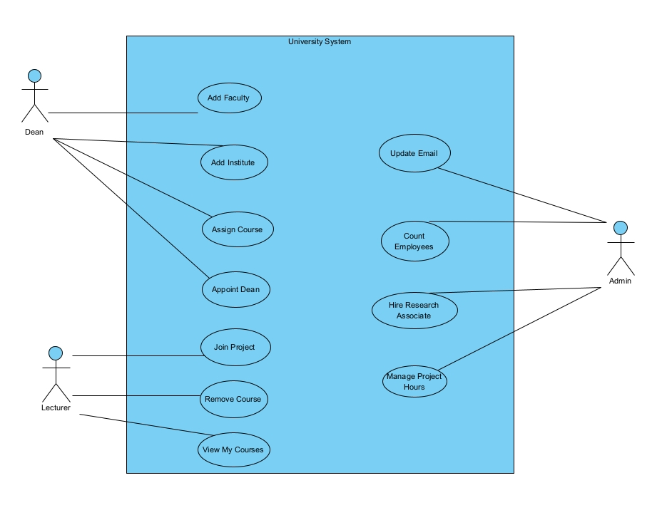
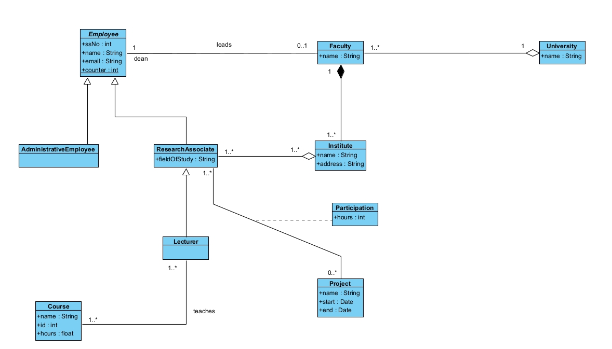
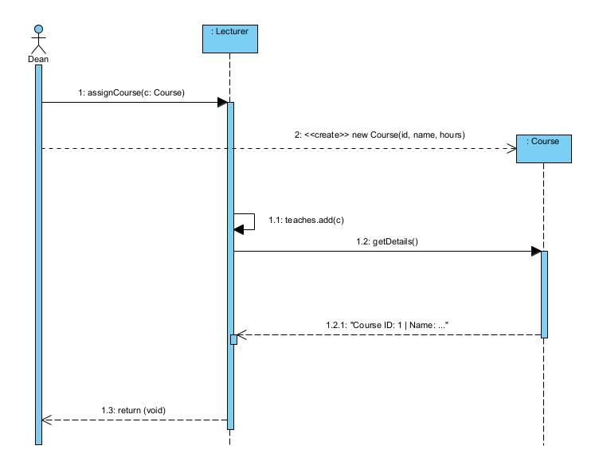
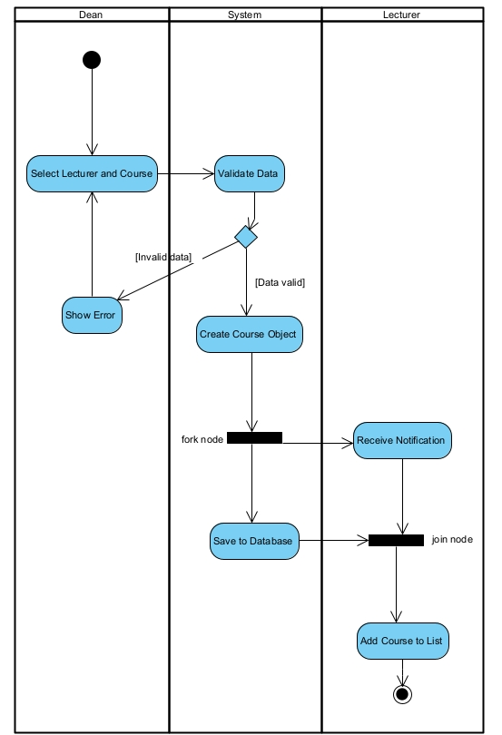
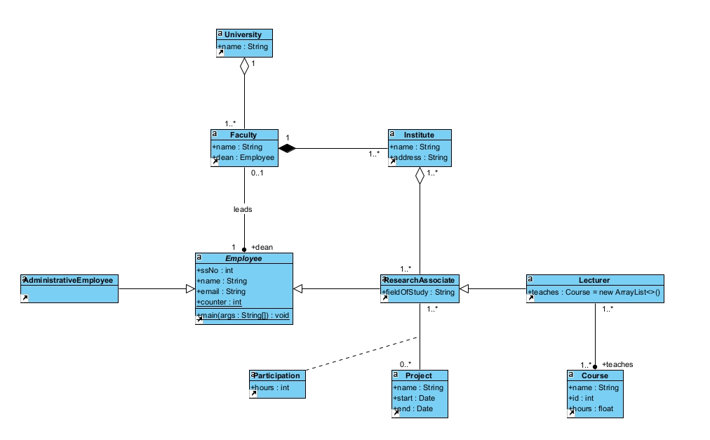

# Lab10PlotnikovMS

## Лабораторная работа UML-моделирование

Тема Университетская информационная система 
Студент Плотников М.С. (10 группа)

### О проекте
В рамках лабораторной работы была спроектирована и реализована объектная модель Университетской информационной системы.

### Java код
Код на языке Java, по которому с помощью реинженеринга заново строилась диаграмма классов, находится в папке `Laboratory10/UniversitySystemJ`.

### Диаграммы
Скрины всех диаграмм и файл проекта vpp находятся в папке `Laboratory10/Diagrams`.

---

## 📊 UML-Диаграммы

### 1. Диаграмма вариантов использования (Use Case Diagram)
Отображает функциональные возможности системы и роли пользователей (Декан, Преподаватель, Администратор).

### 2. Диаграмма классов (Class Diagram)
Показывает структуру системы, классы, их атрибуты, методы и взаимосвязи.

### 3. Диаграмма последовательности (Sequence Diagram)
Демонстрирует процесс назначения курса преподавателю и взаимодействие объектов во времени.

### 4. Диаграмма деятельности (Activity Diagram)
Описывает алгоритм добавления нового курса (Select Lecturer and Course → Validate → Create → Save).

### 5. Диаграмма классов «реинженеринг» (Class Diagram)
Новая диаграмма классов полученная в ходе реинженеринга.

---
